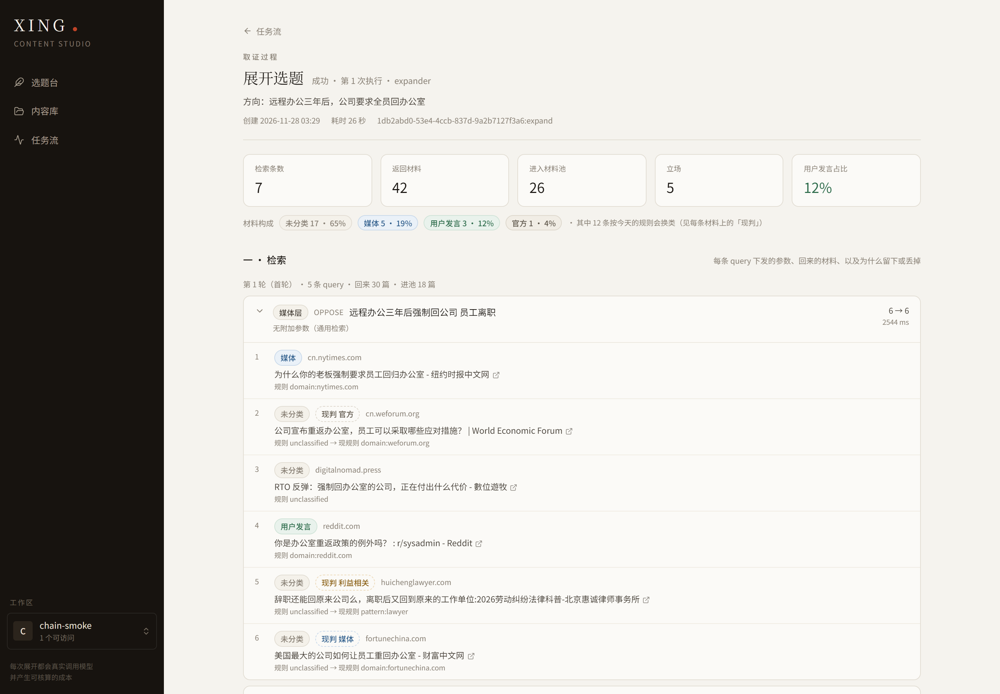

# 选题管线（v0.4）

> 用户输入一个事件或一个方向 → Agent **采集舆论并抽立场** → 生成引用立场的候选
> → **舆论检测** → 打分排序 → 人确认 → 深入（检索真实材料、抽证据）→
> 内容生成 → 审核。
>
> 本文只描述这条链。深度调研（`RESEARCH_DESIGN.md` 那套 objective / gaps /
> 多轮补搜）不属于这条链，它降级为 P3。
>
> 配套阅读：`AGENT_DESIGN.md` §4.1（Orchestrator 只派发）、§5（Runtime 契约）、
> §13（任务图与预算）。

---

## 0. 为什么这条链是主干

内容工厂的产出质量上限由**选题**决定，不由写作决定。写作只是把选定的角度
展开成文本；选题错了，写得再好也只是把平庸放大。

v0.1 的问题是没有检索；v0.2 的问题是**检索只用来校准 why_now，切面仍然来自
模型先验**。结果是六个候选看起来各不相同，却无法回答一个问题：
「这个角度，现实里真的有人在这么说吗？」

v0.3 把因果倒过来：**先采到舆论，再让候选去引用它**。引用不到立场的候选，
代码直接丢掉，不进入检测、不进入打分、不可能被选定。

| | `plan_content` | 选题管线 |
| --- | --- | --- |
| 输入 | 一句 goal | 一个事件或方向 |
| 产出 | 一篇内容 | 立场池 → 多个候选 → 一份带证据的 brief → 一篇内容 |
| 人介入 | 只在最后审内容 | **在中间挑选题** |
| 检索 | 无 | 展开必须采舆论（3~5 条 query）+ 深入多次（建立证据） |

---

## 1. 七环与落点

| 环节 | 谁执行 | 检索 | 写入 | 幂等键 |
| --- | --- | --- | --- | --- |
| 种子输入 | 人 / 上游系统 | — | `tasks.input` | `tasks.dedup_key` |
| 展开 | `expand_topics` | **3~5 次（必须）** | `external_events(SEARCH)` + `opinion_stances` + `topics(CANDIDATE)` + `topic_stances` | `topics.seed_task_id = task.id` |
| 舆论检测 | `check_opinion` | — | `topics.brief.opinion`；不通过置 `REJECTED` | 已有 `opinion.checked` 则复用 |
| 打分 | `score_topics` | — | `topics` 三个分数列 + `brief.score_reason` | 已有分数则复用 |
| 确认 | **人** | — | `topics(SELECTED)` + `decisions` + `decision_traces` + **排深入任务** | `TopicStatus.SELECTABLE` |
| 深入 | `deepen_topic` | **2~5 次（必须）** | `external_events(SEARCH)` + `topic_events(role, weight, quote)` + `topics.brief(DEEPENED)` + `primary_event_id` | `topics.brief.stage == DEEPENED` |
| 生成 | `write_content` | — | `contents` + `content_versions` | `contents.source_task_id` |
| 审核 | `review_content` | — | `approvals(PENDING)` + run.output | `approvals_one_pending_per_stage` |

链是数据推下去的，不是 Agent 记着下一步：`expand_topics` 插一条
`{task_id}:opinion`，检测通过后插 `{seed_task_id}:score`；选定后
`select_topic` 插 `{topic_id}:deepen`；深入跑完插 `{topic_id}:write` 与
`{topic_id}:review`（后者 `depends_on` 写作，由触发器转 READY）。
用户只点一次，链条自己走到成稿。

### 1.1 链路的可观察面：一个派生端点，一个闸门

七环横跨五个 `task_type` 和三张表，但界面只需要回答两个问题：
**走到哪了**、**这一步能不能点**。答案由 `GET /workspaces/{ws}/topics/{id}/chain`
一次给出（`services/chain_service.py`）：

| 字段 | 含义 |
| --- | --- |
| `phase` | `EXPANDING / CHECKING / SCORING / AWAITING_SELECTION / DEEPENING / WRITING / REVIEWING / DONE / FAILED / REJECTED` |
| `steps[7]` | 每环的 `status`（`PENDING/WAITING/QUEUED/RUNNING/RETRYING/DONE/FAILED/CANCELLED/SKIPPED`）、`task_id`、`error`、`retryable`、`waiting_s` |
| `can_select` / `select_blocked_reason` | 能不能选定，不能的原因（`OPINION_PENDING` 等） |
| `review` / `content_id` | 审核结论与成稿指针 |
| `workers_online` | 存活 worker 数；`0` 表示没有进程在消费队列 |

`workers_online` 和 `waiting_s` 是为了回答第三个问题：**它为什么不动**。
队列是拉模型，任务停在 `READY` 可能是「前面排着队」，也可能是「根本没人来领」——
两种情况在界面上完全一样，都是转圈，直到十分钟后超时。所以：

- worker 每 5 秒往 Redis 写一次心跳（独立协程，`cache/heartbeat.py`，TTL 30 秒），
  主循环跑任务时心跳照发，不会把「正在干活」误判成「已经死了」；
- `WAITING` 的步骤带一个 `waiting_s`，界面直接说「排了 2 分 10 秒」；
- 两者同时出现 → 「排队中，但没有 worker 在运行，这条任务不会被领取」，
  而不是继续假装在执行。
- 没有心跳、却有任务挂在 `RUNNING` → 同样算停住。租约回收长在 worker 的主循环里，
  没有 worker 就没人收尸，这条任务会永远停在执行中 —— 它比排队的更该被指出来。

同一个判断在任务流页由 `GET /workspaces/{ws}/queue/status` 给出（`queued` /
`running` / `workers_online` / `oldest_wait_s` / `stalled`）。**「执行中」只包含
`RUNNING/RETRYING`** —— 把 `READY` 算进执行中，就会在 worker 挂掉两小时后
仍然显示「执行中 1」，这正是这次线上现象的成因。

**排产失败也要说出来。** 链路里每一步的下一环是别人排的：`select_topic` 先 commit
选定、再 `create_task` 排深入；`write` / `review` 由 deepener 收尾时一次性排好。
两段中间都有「前一步已完成、后一步还没落库」的瞬间，所以缺失不能立刻判死。
但超过 `_ENQUEUE_GRACE_S`（90 秒）仍然没有任务，就不是空窗而是排产失败：
`get_status` 把那一步标成 `FAILED` 并给出 `DEEPEN_NOT_ENQUEUED` 之类的码，
相位随之变成 `FAILED`，界面上出现重跑按钮 —— 而不是停在上一环「正在执行」直到
前端 15 分钟超时。`deepen` 的排产失败可以重跑（`retry_step` 支持「还没有任务」）；
`write` / `review` 的缺失没有原输入可复制，只报事实、不给按钮。

为什么是派生而不是一张 `chains` 表：任务状态、人的决策、成稿都已经落库了，
再存一份就有第二个真相。寻址全部走 `dedup_key` 的唯一索引，代价是几个定点查询。

**闸门必须在服务层，不能只在界面。** 检测任务和「选定」是两个独立请求，中间有
8~15 秒窗口；`check_opinion` 只捞 `CANDIDATE/RECOMMENDED`，已 `SELECTED` 的题会被
静默排除。所以 `select_topic` 现在强制要求 `brief.opinion.checked` 且 verdict 为
`GROUNDED/WEAK`，否则 409 `OPINION_PENDING` / `OPINION_UNGROUNDED`。界面的
「待检测」灰按钮只是提示，不是防线。

失败不是终点：`POST .../chain/retry {step: deepen|write|review}` 把失败任务让出的
`dedup_key` 交给新任务（旧任务保留在历史里，但不再占键），输入从失败任务复制 ——
重试的是同一次写作，不是重新拼一个可能已经变化的 prompt。

---

## 2. 三个关键决定

### 2.1 `seed_task_id` 与 `primary_event_id` 必须分开

`primary_event_id` 的语义是「这个选题的主证据」，且它上面有
`topics_one_per_primary_event` 唯一索引 —— 一个事件只能挂一个选题。
如果用它表达「从哪个种子展开」，就会与「一个事件展开多个选题」直接冲突。

所以两个字段分工：

- `seed_event_id` / `seed_task_id`：**从哪来的**，无唯一约束，N 个候选共享；
- `primary_event_id`：**主证据是什么**，唯一，在深入阶段才确定。

### 2.2 打分必须是独立的 run

同一个上下文里让模型「把刚想出来的选题打个分」，分数会稳定虚高、且挤在
70~85 的窄区间 —— 排序就失去意义了。所以展开与打分是两个 task、两个 run。

### 2.3 四个分数里只有两个来自模型

| 维度 | 谁给 | 依据 |
| --- | --- | --- |
| `relevance_score` | 模型 | 对照 `strategy_versions.strategy_config` 的受众与调性 |
| `potential_score` | 模型 | 有没有具体、可反驳、带场景的判断 |
| `trend_score` | **算** | 种子事件的新鲜度（24 小时衰减） |
| `risk_score` | **留空** | 缺一份用户可编辑的红线清单，编一个数比 NULL 更糟 |

### 2.4 展开必须查：切面只能来自舆论

v0.2 里展开只有一次「背景检索」，切面全部来自模型先验。v0.3 把这一步拆成
三段，每段都有机检：

```
检索计划  OpinionPlan    3~5 条，必须含 OPPOSE / VOICE / SEGMENT
   ↓
检索       2~5 次         材料落 external_events(SEARCH)，去重后 ≤18 篇
   ↓                     HTTP 型检索并发跑，模型端检索串行（占 call_seq）
   ↓
抽立场     StanceSet      label / camp / claim / audience / quote
   ↓                      quote 必须是材料子串，否则丢弃（无模型参与）
   ↓
补采缺口   查表生成 query  缺哪个声音阵营就补 ≤3 条（模板，不调模型）
   ↓                      新材料 ≤8 篇，再抽一次，按 label 合并去重
立场池     opinion_stances
   ↓
生成候选   GroundedCandidates   每个候选必须给 stance_indexes
```

**补采只针对四个「实义阵营」**：`SUPPORT` / `OPPOSE` / `CONDITIONAL` /
`EXPERIENCE`。`OBSERVER`（旁观分析）缺了不补 —— 它不是分歧的一方，为它多跑
一轮只会带回跑题材料。真实跑里有过一次：只为补 OBSERVER 花了 2 条 query / 8 篇
材料，补回来的立场是「智能化因数字化未完成而受限」，讲的是实体经济，与周报无关。

补采的代价与边界：

- **不调模型规划**。缺口是确定的（缺哪个阵营），措辞也是确定的，为此再问一次
  模型只是白等 4~5 秒：query 由 `_SUPPLEMENT_QUERIES` 模板加种子核心词拼出来
  （`公司要求全员用 AI 写周报 亲历 体验 我`）。只有一次 `analyze`，约 $0.0005。
  代价是 query 比模型写的窄 —— 实测模型规划能补回 3 条立场，模板只补回 1 条；
- 模板 query 的核心词要先剥掉种子的 `方向：` / `事件：` 标签再取第一段。不剥就
  会把「方向」当成核心词，检索出一堆无关材料（第一次接上时真的这样）；
- 第一轮的文档身份会排除掉，不重复喂同一批材料 —— 否则抽出来的立场和第一轮
  一模一样，白花一次分析；
- 补不到（没有新文档 / 新立场全被机检丢掉）**不算失败**，缺口原样留在
  `coverage.missing_camps` 里；
- 补完仍不足 3 立场 / 2 阵营 → `OPINION_TOO_THIN`，错误信息会写明「补采一轮后
  仍缺 X」，让人能区分「没补」和「补了没有」。

硬规则：

- **一条材料都没搜到 → `NO_OPINION_SOURCE`**，直接终态。没有舆论就没有切面，
  不回退到模型记忆 —— 那正是这次改造要消灭的东西。
- **立场不足 → `OPINION_TOO_THIN`**：补采之后仍然不同标签 < 3 或阵营 < 2。只有
  一种声音的题没有分歧可写，不该进入候选。（`stub` 检索器跳过这条：离线环境
  不可能有多种声音，API 返回里会留 `provider=stub`。）
- **候选引用不到立场 → 丢弃**。全部丢弃 → `NO_GROUNDED_CANDIDATE`。
- 立场落库前 `quote` 做子串机检，改写过的句子直接丢，`dropped_stances` 计数。
  这和深入阶段的证据机检是同一套逻辑：可复现，且不依赖 LLM judge。

**为什么候选只看到立场池，看不到原文**：把 18 篇原文塞进生成 prompt，模型会
开始概括材料、写成一堆「背景介绍」。只给立场，它只能在「谁在怎么想」之间
做组合，输出天然是切面而不是综述。

**已知偏差**：舆论可能把题带偏（搜「AI 审批」会带回「影子 AI 数据泄露」）。
这一环不做纠偏，交给 `relevance_score` 兜底 —— 相关度低的候选排不到前面，
人也不会选。宁可偏而被看见，也不要正而靠编。

### 2.5 舆论检测是闸门，不是打分

`check_opinion` 是独立 run（和打分同理：同一上下文自评必然偏松）。它只看到
**立场池 + 候选**，看不到生成过程。判定三条：

| 结论 | 含义 | 处置 |
| --- | --- | --- |
| `GROUNDED` | 切面在立场池里有明确持有者，受众可识别，与其它候选不同 | 保留，排序优先 |
| `WEAK` | 有依据但受众模糊，或与另一候选高度重叠 | 保留，排在 GROUNDED 之后 |
| `UNGROUNDED` | 立场池里没有这个切面，或把个别说法放大成主流 | **`REJECTED`**，不可选 |

两条线合并：

1. **机检（无模型）**：两个候选的「立场集合 + 目标受众」完全相同 → 无论模型
   怎么判，后出现的降为 `WEAK`。换皮是结构事实，不该由可能被措辞骗过的模型
   裁决。
2. **模型判**：持有者是否存在、受众是否可识别、与谁重叠。**明确不判真假** ——
   真假是深入阶段的事；否则会把「我不认同这个观点」误判成「这个观点不存在」。

覆盖度（阵营分布、材料数、来源数、缺失阵营）由 SQL 算出并写进
`brief.opinion.coverage`，不经过模型。检测结论写 `brief.opinion`，被拒的
候选保留原因，仍然可见 —— 只是不能选。

### 2.6 证据三层与机检

```
检索材料  external_events(source_type=SEARCH)
             ↑ external_id = sha256(url | 出处+标题+片段)，天然去重
立场      opinion_stances(seed_task_id, event_id, label, camp, claim, audience, quote)
             ↑ (seed_task_id, event_id, label) 唯一；quote 已机检
选题      topics ← topic_stances → opinion_stances
             ↑ 没有引用的候选不落库
证据关系  topic_events(topic_id, event_id, role, weight, quote)
             ↑ role ∈ PRIMARY / SUPPORTING / CONTRADICTING / BACKGROUND
论证结构  topics.brief(DEEPENED) = thesis / outline / counterpoints /
                                  differentiator / evidence_refs / search
```

深入阶段的两条硬规则：

1. **`quote` 必须是材料片段的子串**（折叠空白后比较）。模型可以把 `claim`
   写成自己的话，但引文必须逐字 —— 改写过的直接丢，`rejected_quotes` 计数。
   这一步没有模型参与，所以结论可复现；交给 LLM judge 判「意思是否相近」，
   恰恰最容易被相似措辞骗过。
2. **全部引文不合法时用材料原文兜底**成 BACKGROUND，不失败、也不假装成功。
   降级写在 `brief.search.degraded` 上。

### 2.7 检索后端：两种前提，一个接口

`src/xing/search/` 里三个实现，配置 `SEARCH_PROVIDER` 选：

| provider | 返回什么 | 证据能回溯到 | 花费 |
| --- | --- | --- | --- |
| `stub` | 确定性假材料 | 无（`degraded=True`） | 0 |
| `tavily` | 标题 + 链接 + 正文片段 | **网页原文** | 按次 |
| `qwen` | 模型联网检索后的结论 + 原话 + 出处 | **媒体名 + 日期**（通常无链接） | token |

`qwen` 走 `runtime.call_model(web_search=True)`，不自己发 HTTP：模型联网一次
约 7000 input tokens，绕开 Runtime 就等于绕开预算与账本。代价是回放键要区分
带不带联网（`make_replay_key` v2），预留额度要加 `search_context_chars` ——
因为检索正文是供应商注入的，不在我们发的 prompt 字符数里，不加就会
「预留不是花费上界」，结算时撞预算 CHECK。

**已知取舍**：`qwen` 不给可点击链接。要原文可点，用 tavily。

### 2.8 检索分层：媒体层 / 讨论层 / 补采层

一次展开不是「跑一遍模型的 query」。按「想听谁说话」分三层，每层下发的参数
不同 —— 这是 v0.4 补的，起因是**搜回来的东西全是媒体**：模型的 query 写成
「远程办公 强制回公司 争议」，返回的是纽约时报、新浪、麦肯锡，全是有人在
编辑、但没人在表达自己处境的地方。

| 层 | query 从哪来 | 真正下发的 `options` | 为什么 |
| --- | --- | --- | --- |
| `MEDIA` | 模型规划（`OpinionPlan`） | 默认（通用检索） | 找争论的来路、事实、时间线 |
| `DISCUSSION` | 模板：`{core} 怎么看` / `{core} 亲历 真实感受` | `include_domains=DISCUSSION_DOMAINS`、`time_range=year` | 找具体的人在说什么；不限定站点就还是媒体 |
| `SUPPLEMENT` | 缺口模板（见 §2.4） | 同 MEDIA | 缺哪个阵营补哪个 |

两个决定值得记下：

- **讨论层收窄时间窗，媒体层不收**。用户发言时效性极强：三年前的微博说不了
  今天的舆论，而三年前的分析文章仍能说明这场争论的来路。所以
  `DISCUSSION_TIME_RANGE = "year"`，媒体层不设 `time_range`。
- **讨论层必须 `include_domains`，不能靠 query 措辞**。实测「知乎 怎么看」这种
  写法仍然会带回媒体文章 —— 搜索引擎按相关性排，媒体页的相关性天然更高。
  只有站点白名单（`weibo / zhihu / xiaohongshu / douban / tieba / v2ex /
  bilibili / hupu / x.com / reddit`）能真正把结果按「谁在说话」切开。直接打
  tavily 验证过：同样的 query 加 `include_domains`，4 条结果全来自
  `zhuanlan.zhihu.com`。

`SearchOptions` 有三个字段：`topic`（`general` / `news`）、`time_range`、
`include_domains` / `exclude_domains`。**留空与传 None 语义不同**，所以轨迹
记的是 provider 回传的 `options`（真正生效的那组），不是调用方传的那组 ——
「讨论层到底有没有限定站点」因此可以被核对，不用信任代码。

### 2.9 来源分层：谁在说话

材料按域名分类，写进 `external_events.source_kind`：

| kind | 含义 | 例 |
| --- | --- | --- |
| `MEDIA` | 有人在编辑，但不在表达自己处境 | nytimes / 36kr / sina |
| `UGC` | 具体的人在说话 | zhihu / reddit / weibo |
| `OFFICIAL` | 机构口径 | `.gov.cn` / `.edu.cn` / `who.int` / `un.org` |
| `VESTED` | 律所 / 厂商 / 咨询 / 公关稿 | `pattern:lawyer` / mckinsey / 云厂商 |
| `UNKNOWN` | **没认出来**，不是不重要 | 个人站 / 冷门垂直站 |

判定逻辑在 `search/sources.py`，`classify(url)` 返回 `(kind, rule)`，`rule` 是
命中的那条规则（`domain:zhihu.com` / `suffix:.ac.cn` / `pattern:lawyer` /
`unclassified`）。**判错时先看 rule，不是先看结论**：结论对了可能是蒙的，
规则对了才是可复现的。

几个真实踩过的坑，都在测试里钉住了：

- 国别域名不归一 → `mckinsey.com.cn` 认不出。`registrable()` 处理
  `com.cn` / `co.uk` / `ac.jp` 这类两级 TLD；
- 后缀表漏 `.ac.cn` → 中科院系统全成 UNKNOWN；
- 律所只按域名白名单匹配 → `huichenglawyer.com` 这种一客一域名的永远对不上，
  改成 `_VESTED_PATTERNS` 关键词命中；
- 没有 URL 的材料（`qwen` 端检索）只能按媒体名标签判，认不出就 UNKNOWN ——
  不猜。

`source_kind` 与 `source_type` **正交**：后者记「怎么进来的」（SEARCH / NEWS /
SOCIAL），前者记「什么性质」。一条 SEARCH 进来的材料完全可能是 UGC。

覆盖度统计（`brief.opinion.coverage.source_mix` / `ugc_ratio`）由 SQL 按
`source_kind` 现算，**不在写入时固化成指标** —— 分类表改了，读出来的数字立刻
跟着变，不用回填历史数据。

### 2.10 取证轨迹：`retrieval_traces`

原来这一步是黑盒：一次检索计划、一次立场抽取，中间只剩日志，重启就没了。
于是「为什么这题缺 CONDITIONAL」「这条立场凭什么算 UGC」只能靠猜。

`retrieval_traces` 一次检索一行：`layer` / `query` / `target` / `provider` /
**真正下发的 `options`** / `status` / `latency_ms` / `result_count` / `new_count`，
以及 `docs`（jsonb，一条 query 的结果天然是数组，拆表只会让读取变 N+1）。

`docs` 里每条记 `rank / title / url / domain / source_kind / kind_rule /
published_at / kept / drop_reason`。**没采用的也要记**，因为「为什么没采用」
和「搜到了什么」是两件事：

| `drop_reason` | 含义 | 该怎么处置 |
| --- | --- | --- |
| `EXCLUDED_PREVIOUS_ROUND` | 补采时上一轮已有 | 正常，去重生效 |
| `DUPLICATE` | 本轮多条 query 撞车 | 正常；撞得多说明 query 写重复了 |
| `OVER_LIMIT` | 超 `MAX_DOCS` | 该调上限，或说明这一轮搜太宽 |

三条不变量：

1. **`attempt = retry_count + 1` 过滤**。重试会留下上一趟的轨迹，混着看会以为
   「这一轮搜了 12 条」；
2. **写轨迹失败不阻断业务**。观测手段不能绑架业务：`_record_traces` 吞异常只
   记日志，`ON CONFLICT DO NOTHING` 打在 `(task_id, attempt, round, seq)` 上；
3. **只增不改**。`xing_app` / `xing_worker` 对该表只有 `SELECT, INSERT`。注意
   `scripts/app_role.sql` 里有 `GRANT ... ON ALL TABLES`，它会把这个限制重新
   打开，所以那里也补了一次 `REVOKE`，`tests/sql/p0_check.sql` 的 P0-6 常驻看守。

**快照 vs 现判**：轨迹是那一趟的记录，`source_kind` 写入后不改。但分类表会变，
旧轨迹上会留着一批「未分类」，读的人容易以为分类器认不出来，去补一条其实已经
补过的规则。所以读接口额外给 `source_kind_now` / `kind_rule_now`（只在今天会
判成别的时才出现），页面上并排显示「当时判成 X · 现判 Y（规则 Z）」。

真实例证：v0.4 首次跑的那条轨迹，26 篇进池材料里有 **12 篇**按今天的规则会换类
（未分类 → 官方 6 / 媒体 3 / 利益相关方 2 / 用户发言 1）。按今天的分类表重算，
来源构成是 **MEDIA 8 (31%) / OFFICIAL 7 (27%) / UNKNOWN 5 (19%) / UGC 4 (15%) /
VESTED 2 (8%)** —— 和当时存下的 65% UNKNOWN 完全不是一回事。**不要拿旧轨迹下
结论**，这是 `source_kind_now` 存在的全部理由。

---

## 3. 迁移

`0009_topic_pipeline`：`topics.seed_task_id / seed_event_id / brief` +
两个复合外键。两个细节：

- **复合外键而不是单列**：worker 是 `BYPASSRLS`，RLS 挡不住写错租户的
  `seed_task_id`，只有复合外键能挡（0007 踩过）。
- **`ON DELETE SET NULL (列)`** 是 PG 15+ 的定向置空语法。不指定列的话，
  `SET NULL` 会连 `workspace_id` 一起置空，而它是 NOT NULL —— 删除时直接报错。

`0010_topic_evidence_quote`：`topic_events.quote`。

只有一列，没有新表：证据是「选题 ↔ 外部事件」这条关系的属性，关系表已经在了。
再加一张 `topic_evidence` 会让「这个选题有哪些证据」有两个答案。

`0011_opinion_stances`：舆论立场两张表 + `topics` 的 `(id, workspace_id)` 唯一约束。

- `opinion_stances`：一次展开采集到的立场，`quote` 指回 `external_events`。
  `(seed_task_id, event_id, label)` 唯一，展开重跑靠它 upsert，不需要 DELETE。
- `topic_stances`：候选引用立场，多对多。**这是「禁止模型先验」的落地点**：
  没有引用的候选不落库；引用了不存在或跨租户的立场，复合外键直接拒绝。
- 为什么不用 `topics.brief` 存：一份立场会被多个候选引用，而且需要保留到原文
  的溯源。塞进 jsonb 之后，外键就没了，「这个候选凭什么这么切」也只能靠人读 JSON。

`0012_retrieval_trace`：`external_events.source_kind` + `retrieval_traces`（见 §2.8~2.10）。

- `source_kind` 单列 + CHECK + `idx_external_events_kind`：来源构成是「按租户 +
  类型」扫的聚合，没这个索引每次都要全表；
- `retrieval_traces` 的 `docs` 存 jsonb 而不是拆表：一条 query 的结果天然是一个
  数组，而这表唯一的用法就是「整段读出来给人看」，拆表只换来 N+1；
- **不塞进 `tasks.output`**：补采会追加第二轮，任务重试又会覆盖，而轨迹的价值
  恰恰在于「失败时也还在」。它是诊断数据，必须独立于业务结果；
- 授权只给 `SELECT, INSERT`，并且必须在迁移里 `REVOKE` —— `app_role.sql` 对
  未来表的 `DEFAULT PRIVILEGES` 是 `SELECT, INSERT, UPDATE, DELETE`，光写 GRANT
  挡不住。

---

## 4. 权限

`scripts/worker_role.sql`：

- `topics`：`SELECT, INSERT, UPDATE`（expander 建、scorer 改分、deepener 写 brief）；
- `topic_events`：`SELECT, INSERT, UPDATE`（deepener 写证据）；
- `opinion_stances`：`SELECT, INSERT, UPDATE`（expander 写立场，重跑 upsert）；
- `topic_stances`：`SELECT, INSERT`（引用关系是断言，不给 UPDATE）。
- **没有任何一张表给 `DELETE`**：选题只被 REJECTED/EXPIRED；证据与立场只增不删，
  删了「当时凭什么这么写」就答不出来了。重跑靠唯一键 upsert，不会堆重复行。

改完要跑一次 `./dev.sh workerrole`，否则会以
`permission denied for table opinion_stances` 失败。

---

## 5. 真实首跑（2026-11-26，v0.3）

`LLM_PROVIDER=openai SEARCH_PROVIDER=tavily python scripts/run_topic_chain.py`
输入方向：「企业给 AI 审批签字这件事，为什么没人愿意做第一个」。

| 环节 | 结果 |
| --- | --- |
| 检索计划 | 5 条，含 `OPPOSE`（法律风险追责）与 `VOICE`（法务总监拒绝经历） |
| 展开 | 18 篇材料 → 抽 6 条立场（OBSERVER×3 / OPPOSE×2 / SUPPORT×1），`dropped_stances=0` |
| 候选 | 6 个，全部引用立场；`dropped_candidates=0` |
| 舆论检测 | 3 `GROUNDED` / 3 `WEAK` / 0 `UNGROUNDED`；两条因「与其他候选立场和受众完全相同」被机检降级 |
| 打分 | 前三 0.85 / 0.85 / 0.80（rel·pot），`trend` 为空（方向型） |
| 深入 | 4 条 query → 16 篇 → 4 条证据，`rejected_quotes=0` |
| 审核 | **FAIL 55** |
| 成本 | 10 次调用，0.0033 美元 |

四条观察：

1. **候选第一次能说清「谁在这么说」。** 6 个候选分别建立在「警惕影子 AI」
   「审批节点是合规举证的关键」「反对用 AI 记录替代人工签字」这些真实报道里的
   说法上，`opinion_stances.quote` 可以逐条回查原文。
2. **换皮被机检抓住了。** 两个候选都引用「明确追责主体 + 企业承担最终责任」、
   都写给「企业法务/风控」，模型也判了重叠 —— `WEAK`，排在后面。这不是提示词
   劝出来的，是 `(立场集合, 受众)` 这个键算出来的。
3. **覆盖度是诚实的。** `coverage.missing_camps = [CONDITIONAL, EXPERIENCE]`：
   检索计划里有 VOICE，但抽出来的立场里没有第一人称说法。它没有补一个假的
   「亲历者」进来，而是把缺口写进 brief。
4. **舆论会把题带偏。** 输入是「审批签字为什么没人愿意做第一个」，回来的候选
   有两条偏到「影子 AI 数据泄露」。相关度打分把它们压在 0.85 以下，但这是这一版
   的真实代价：**宁可能被看见地偏，也不要正而靠编。**

### 5.1 第二次跑：换一个自带对立的题（同日）

同一个库、同一套配置，输入方向换成「公司要求全员用 AI 写周报：效率提升，还是新的形式主义」。
这一跑的意义是看闸门在「立场阵营本来就不全」时怎么判。

| 环节 | 结果 |
| --- | --- |
| 展开 | 18 篇材料 → 5 条立场（OPPOSE×3 / OBSERVER×1 / EXPERIENCE×1），`dropped_stances=1` |
| 候选 | 6 个，全部引用立场；`dropped_candidates=0` |
| 舆论检测 | 5 `GROUNDED` / 1 `WEAK` / 0 `UNGROUNDED` |
| 打分 | 3 个 `RECOMMENDED` |
| 成本 | 6 次调用，0.0021 美元 |

三条观察：

1. **`repair` 真的会被用到。** `analyze` 第一次返回的 JSON 在第 1178 字符处断了逗号，
   `runtime.call_structured` 走了一次 `repair` 才拿到合法 `StanceSet`。这不是失败，
   是设计里留的那一步；`llm_calls` 里两条记录并存，成本都算进去了。
2. **模型也会判 `WEAK`，机检只判它擅长的部分。** 那条 `WEAK` 引用了立场 [1][2][5]，
   但模型指出「核心论点没有对应阵营」且「受众与前几个候选重叠」—— 这是语义判断，
   机检做不到。反过来「两个候选立场集合与受众完全相同」这种结构事实，机检算得比
   模型稳。两层各管一段，谁也不替代谁。
3. **阵营不全不阻断，但会留痕。** `missing_camps = [SUPPORT, CONDITIONAL]`：这个题的
   真实讨论里几乎没人替「强制 AI 周报」说话，也没有「有条件支持」的中间立场。
   系统没有为了凑齐五种声音去编一个支持者 —— 5 条立场 / 2 个阵营过了阈值（≥3 / ≥2），
   照常出题，缺口写进 `coverage`。（v0.3.1 起这两类缺口会先触发一轮补采，见 §5.2。）

### 5.2 补采的两次真实跑（同一方向，收窄前后对比）

> 本节是 v0.3.1（**模型规划 query**）的实测记录，保留是为了说明「为什么只补四个
> 实义阵营」。v0.4 把规划换成模板查询，query 形态与耗时见 §5.4。

同一个方向连跑两次，专为验证补采：第一次按「五个阵营全算缺口」，第二次把触发
条件收窄到四个实义阵营。

| | 第一轮缺 | 补采 query | 新增 | 补完 |
| --- | --- | --- | --- | --- |
| 收窄前 | `OBSERVER` | 2 条（知乎 / 36kr 的行业分析） | 8 篇 → 1 条立场 | `missing=[]` |
| 收窄后 | `EXPERIENCE` | 2 条（「我坚持用 AI 写周报三个月后」「作为产品经理…个人经历」） | 8 篇 → 3 条立场 | `missing=[]` |

两次都补到了缺口，但只有一次补对了东西：

1. **为 OBSERVER 补采会跑题。** 收窄前那一轮，第一轮已经有四个阵营，只差旁观
   评论。补回来的 OBSERVER 是「智能化因数字化未完成而受限」—— 讲的是实体经济
   与数字化改造，跟「AI 写周报」没有关系。它通过了引文机检（确实有人这么说过），
   也进了立场池，但和这道题无关。**这不是引文机检能拦的问题**：引文是真的，
   相关性才是假的。所以触发条件改为只补「构成一边声音」的四个阵营。
2. **为 EXPERIENCE 补采是对的。** 收窄后那一轮缺亲历者，补回来的三条都是
   「我用了一段时间之后的真实感受」这类第一人称材料，正好是候选最缺、也最难
   凭空想出来的那种切面。
3. **代价可算。** 补采一轮 = 1 次 `plan` + 1~2 次检索 + 1 次 `analyze`，
   实测约 $0.0007，材料上限 8 篇（第一轮的文档不重复喂）。

### 5.3 补采抽不到东西，曾经把整条链判死

第三次跑（同一方向）暴露了一个自己埋的坑：补采到的 8 篇材料里，模型
一条立场都没抽出来，返回 `{"stances": []}`。而 `StanceSet` 当时写着
`min_length=3`，于是 Pydantic 直接抛校验错 → `repair` 再问一次 → 还是空 →
整个展开以 `INVALID_OUTPUT` 失败。

**错在把采样结果当成了格式错误。** 模型的行为是对的（材料里确实没有可用立场），
格式也是对的（空列表合法），被判死的却是整条链。更糟的是诊断：用户看到的是
「结构化输出两次不合法」，而不是「补采没补到」。

修正两条：

- `StanceSet.stances` 去掉下限。空列表合法，由调用方按轮次判定：
  第一轮为空 → `NO_STANCE_EXTRACTED`；不满 3 条 / 2 阵营 → `OPINION_TOO_THIN`；
  补采轮为空 → 缺口照实记录，继续出题。
- 补采用独立的 `SYSTEM_STANCES_SUPPLEMENT`：明确告诉模型「这批材料可能只够
  一两条，甚至一条都没有，有多少给多少」，不再用第一轮那句「至少给出 3 条」——
  在补采语境里那句话会逼它编。

真实留痕长这样（`brief.sources.supplement`，界面直接展示）：

```json
{"rounds": 1, "new_docs": 8, "new_stances": 0,
 "missing_before": ["SUPPORT", "CONDITIONAL", "EXPERIENCE"],
 "missing_after":  ["SUPPORT", "CONDITIONAL", "EXPERIENCE"]}
```

### 5.4 耗时构成：时间几乎全在模型生成

两次真实跑（tavily + qwen3.7-flash，完整七环）的分段耗时：

| 环节 | 调用 | 耗时 | 其中模型 |
| --- | --- | --- | --- |
| 展开 | `plan` + `analyze` + `analyze`（补采）+ `generate` | 26.6s | 20.6s |
| 舆论检测 | `self_check`（+1 次 `repair`） | 14.3s | 14.2s |
| 打分 | `self_check` | 3.7s | 3.7s |
| 深入 | `plan` + `generate` | 25.4s | 15.3s |
| 写作 | `generate`（1433 tokens） | 19.9s | 19.9s |
| 审核 | `self_check` | 2.4s | 2.4s |

结论：**模型生成速度是硬约束**。实测输出速率约 70~90 tokens/s，选题链（展开 +
检测 + 打分）一次要生成 2000 tokens 左右，就是 25~30 秒。这部分改架构消不掉。

v0.4 只削掉了结构性浪费，没有也不可能削掉生成时间：

1. **检索并发**（`Searcher.concurrent_safe`）：3~5 条 query 从串行 6~8 秒降到
   2 秒左右。模型端检索不能并发（要在同一个 run 里占 `call_seq`），由实现方声明；
2. **补采不再调模型规划**：省一次 4~5 秒的 `plan`；
3. **并发后仍按 query 顺序归并**：`stored` 的编号会被立场抽取按 `doc_index` 引用，
   顺序随网络返回早晚漂移会让同一批材料的编号不可复现。

有补采的展开因此从 35~42 秒降到 26.6~31.9 秒（约 -25%）。

剩下的可选项都是产品取舍，不是 bug：

- 候选 6 → 4：`generate` 少约 1/3 输出，省 3 秒左右；
- 检测与打分合并成一次调用：省 5 秒，但两者共享上下文会互相抬高 —— 这正是它们
  现在是两个独立 run 的理由；
- 换更快的模型：延迟会降，质量与成本要重新评测。

写作那 19.9 秒是 v0.4 **主动加上去的**：篇幅档把输出从约 750 tokens 提到
1400+，成稿从 700~1100 字变成 2100~2600 字。想快可以调回短档，但那就回到
「文章过短」的老问题。

---

## 6. 已知缺口与顺序

| 缺口 | 现状 | 触发条件 |
| --- | --- | --- |
| **审核 FAIL 之后没有自动返工** | 可以手动 `POST .../chain/retry` 重跑审核/写作，但 `issues` 不会自动变成新 brief | 下一步：`review→write` 自动回环，把 issues 拼进 brief 重写一次（上限 1 次） |
| 单 worker 串行 | `worker/main.py` 一个循环一次只领一个任务；长任务阻塞所有租户（实测一条 expand 排队等过 400s） | 并发池或按 agent 拆进程；`call_seq` 只在同一 run 内唯一，跨任务并发不冲突 |
| 缺失阵营只补一轮 | 四个实义阵营缺了就补一次；补不到就留痕 | 仍缺时第二次补采要换检索源（如站内/垂类），同源重试没有意义 |
| 候选可能与种子漂移 | 靠 `relevance_score` 事后压制 | 生成时把「必须回答种子」也做成机检，或给候选加 `seed_fit` 字段 |
| `trend_score` 没有批次内区分度 | 只有种子新鲜度 | 接入热榜 + `event_metrics(event_id, captured_at, rank)` 时间序列 |
| `risk_score` 恒 NULL | 缺红线清单 | 用户产出可编辑红线后，规则优先、模型补充 |
| 用户导入的文档还不能当证据 | 只有 web 检索 | `document_chunks` + pgvector，作为第三类检索源接进 `_search_all` |
| 候选可能同质化 | 机检只抓「立场集合 + 受众完全相同」的换皮 | 语义相近但措辞不同的换皮仍靠提示词；需要时加 angle 两两相似度 |
| 结构化输出偶发 `repair` | 单次多花 4~11 秒（检测 4.2s、深入 11.3s 都实测过） | 收紧 shape、降输出上限；频率高再看流式修复，现在只是一步兜底 |
| 列表顺序不体现打分分层 | `/topics` 按 `discovered_at desc`，`overall` 不落库 | 分层只体现在 `RECOMMENDED` 标记上；候选超过一屏时改成 `order by tier, overall`（要在 API 暴露 overall 或落 tier 列） |
| `qwen` 证据无链接 | 只能回溯到媒体+日期 | 有 tavily key 时切 `SEARCH_PROVIDER=tavily` |
| **判定阈值没接来源构成** | `check_opinion` 的 `GROUNDED / WEAK` 还是纯语义判定，`source_mix` / `ugc_ratio` 只写进 coverage 给人看 | 已量出真实分布（MEDIA 31% / OFFICIAL 27% / UNKNOWN 19% / UGC 15%），可以定线了：全 MEDIA 最高 `WEAK`；`ugc_ratio = 0` 最高 `WEAK`；近一年占比过低降一档。**先定线再加规则**，否则会把「这题确实只有媒体在写」误杀 |
| 讨论层召回仍偏弱 | 打开 `include_domains` 后 UGC 只占 15%，且大多没进立场池（第一条轨迹里 3 篇 UGC 只有 1 篇被引用） | 讨论层目前只有两条模板 query；下一步按阵营缺口语义化生成（「谁在反对」而不是「亲历 真实感受」），并检查 UGC 材料是否因为片段太短被机检丢掉 |
| 轨迹只覆盖展开 | `deepen` / `write` 已有 `agent_runs` + `llm_calls`，但没有检索轨迹（它们不检索） | 若以后接文档检索，同一张表加 `layer=DOCUMENT` 即可，`CHECK` 要放开 |
| **同一 attempt 被重跑会撞 `agent_runs_task_attempt`** | 唯一约束是 `(task_id, attempt)`，`attempt = retry_count + 1`。而 fencing 会让「跑完但状态写入被作废」的任务被重新领取并**在同一 attempt 上再跑一次**，第二次 `INSERT agent_runs` 直接唯一冲突，白烧一次重试额度（真实日志见过：`retry=1`，错误是 unique violation） | 二选一：①`attempt` 改成「执行次数」而不是「重试次数 +1」，由 `tasks.lease_generation` 派生；②插入改成 upsert 并复用同一行。①更符合语义（fencing 的目的就是允许同一任务被执行多次），但要同步改 `retrieval_traces.attempt` 的口径 |

**顺序建议**：先做「审核 → 自动返工」闭环（手动重跑已经有了，缺的是把 issues 自动化），
再做 worker 并发（它决定第二个租户能不能用），然后接文档检索，最后才是热榜。

---

## 7. 验收

`pytest`（88 例）里与本链相关的是四组：

| 文件 | 覆盖 |
| --- | --- |
| `test_topic_pipeline.py` | 展开采舆论、立场机检、无引用候选被丢、补采触发（模板 query / 核心词剥标签 / 合并去重）、检测闸门（换皮降级 / UNGROUNDED 拒绝）、空检索与薄舆论终态、排序 |
| `test_chain_status.py` | 七环派生（检测未完成时 `can_select=false`）、失败步骤可重跑、重跑让出 `dedup_key` 且只留一条活任务、审核结论回传、选定闸门（`OPINION_PENDING` / `OPINION_UNGROUNDED`） |
| `test_deepen.py` | 深入落证据、引文机检、重跑幂等、跨租户拒绝、选定自动排产、写作 prompt 带编号 |
| `test_agent_contracts.py` | 新增 `OpinionPlan` / `StanceSet` / `GroundedCandidates` / `OpinionVerdicts` 的 shape ↔ 模型逐对校验 |

六道防线：`lint / typecheck / ormcheck / dbsmoke / rlscheck / pytest`。

> 跑 pytest 前先 `docker compose stop worker`。后台 worker 会真的领取测试
> 建的 READY 任务，表现为「任务一直是 READY，测试却说没跑」——
> 这不是代码问题，是队列里有两个消费者。

---

## 8. 界面（web/）

前端不重新编排链路，只做两件事：**提交一次展开任务**、**轮询链路状态**。
真实状态永远在数据库里，前端不给乐观进度 —— 任务会重试、会失败、会被回收，
自己往前跑会显示一个库里并不存在的「已完成」。

**工作区是 URL 的第一段**：`/w/:wsId/studio|contents|contents/:id|tasks`。
切换工作区 = 一次导航 = 组件重挂，所以不存在「切了租户但视图还显示上一个租户数据」
这种状态；链接也因此可分享。守卫会把旧地址（`/studio`、`/contents/:id`）和
`?ws=` 补成带工作区的地址，历史书签仍然可用。

| 页面 | 作用 | 关键调用 |
| --- | --- | --- |
| 选题台 | 种子 → 候选 → 选定 → 成稿 | `POST /tasks`（expand）→ `GET /tasks/{id}` → 轮询 `GET /topics/{id}/chain`（展开/检测/评分）→ `POST /topics/{id}/select` → 继续轮询同一个端点直到 `DONE` |
| 选题详情 | 舆论基座（引用到的立场）+ 检测结论与覆盖度 + 深入产出 | 全部来自 `topics.brief`（`stances` / `opinion` / `outline` / `evidence_refs`），没有额外接口 |
| 内容库 / 详情 | 读成稿、看审核 issue、人工通过或驳回 | `GET /contents`、`/versions`、`/approvals`；审核结论取自 `chain.review`，不再去任务表里捞 `review_content`（翻页翻掉了就等于「没有审核」，会骗人） |
| 任务流 | 每一步的实际状态、排队时长、失败码；没有 worker 时直接说出来 | `GET /tasks` + `GET /queue/status`，4 秒轮询（页面不可见时暂停） |
| 取证过程 | 一个任务具体怎么搜、怎么想、怎么判：检索（每条的参数/规则/丢弃原因）→ 立场（原文引句）→ 模型步骤（system/prompt/响应） | `GET /tasks/{id}/trail`。**单独端点**：详情是 4 秒轮询的高频路径，轨迹是大载荷、几乎不变 |

取证页的入口有两处，都带 `v-if` 防死链：选题详情里「看这次检索的取证过程」
（要求 `topic.seed_task_id` 非空）、任务流展开区的「取证过程」按钮。
页面上有五个数字（检索条数 / 返回材料 / 进池 / 立场 / 用户发言占比）和一条
材料构成 chip，下面是可展开的逐条 query —— 每一行都能看到「下发了什么参数」
「命中了哪条分类规则」「为什么没采用」。



**查看历史轨迹时注意 `现判` 标记**：分类表改过之后，旧轨迹上的 `未分类` 会
并排显示一个虚线标签「现判 官方」，规则行显示 `unclassified → 现规则
domain:weforum.org`。这是有意的：旧结论不改写，但也不让它冒充今天的能力。

链路状态只有一个来源：`GET /topics/{id}/chain`。前端不再按
`task_type + input.topic_id` 在任务列表里找某一步 —— 列表有 limit，
任务多了这一步就「消失」，而消失的表现是一直转圈。失败时同一端点给出
`failed_step` 与可重跑的步骤，界面直接渲染 `POST .../chain/retry` 的按钮。

**「在执行」和「没人执行」必须分开显示。** `READY` 的任务没有任何进程在跑它，
所以它不算「执行中」；判断依据是 backend 的心跳（`workers_online`）加排队时长
（`waiting_s`），不是界面自己的猜测。没有 worker 时，选题台的进度条变成黄色警告
「已排队 2 分 10 秒仍没人领取」，任务流页给出启动命令 —— 而不是转圈到超时。

四个必须知道的约束：

1. **选定需要一条 ACTIVE 战略**。`select_topic` 要写决策并绑定战略版本，
   没有生效战略会返回 `409 NO_ACTIVE_STRATEGY`。界面把这条前置条件做成了
   可修复的提示：一键创建并激活「默认内容战略」。
2. **`review_content` 的 `task.output` 必须带 `issues`**。此前只有 `agent_runs.output`
   有完整判定，任务输出漏了 `issues`，界面能看到 FAIL 却不知道改什么。
   已在 `agents/reviewer.py` 补齐 —— 对外暴露的是 `task.output`，不是 run 的内部记录。
3. **选定必须先过舆论检测**。检测没跑完时 `select` 返回 `409 OPINION_PENDING`，
   判 `UNGROUNDED` 的候选是 `REJECTED`（`409 OPINION_UNGROUNDED`）。
   卡片上对应「待检测 / 未通过检测」，按钮不可用 —— 但真正的拒绝在服务层。
4. **种子目前只支持方向型**。`expand_topics` 的 `seed_type=event` 需要先有事件，
   界面还没做事件选择器；事件型链路仍由脚本验证。

测试与真实模型的解耦：`tests/conftest.py` 在导入应用前强制 `LLM_PROVIDER=stub`，
所以 `.env` 可以切到真实模型供界面使用，`pytest` 仍然离线、可复现、不花钱。
